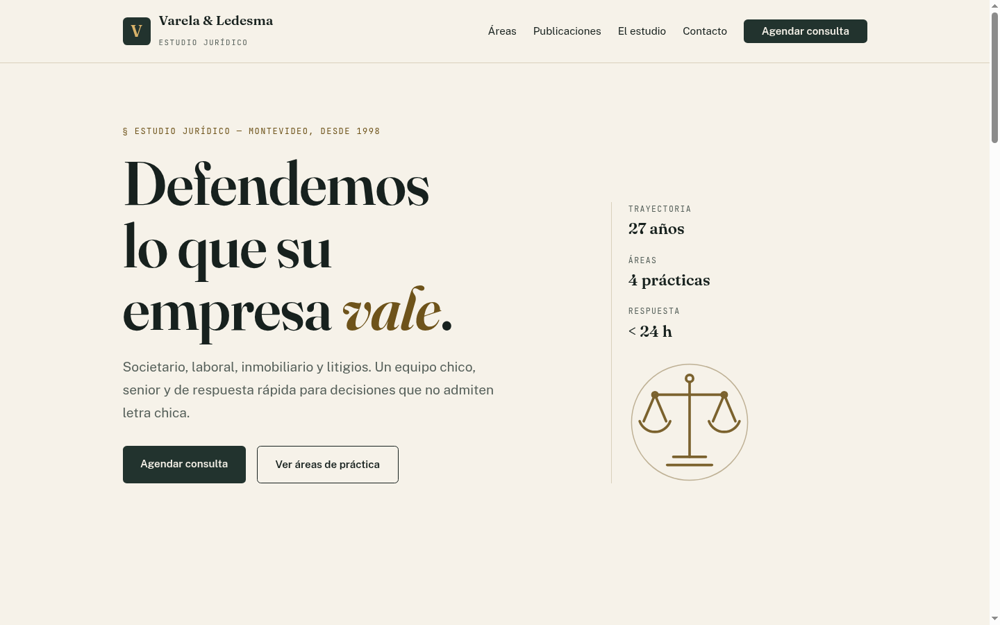
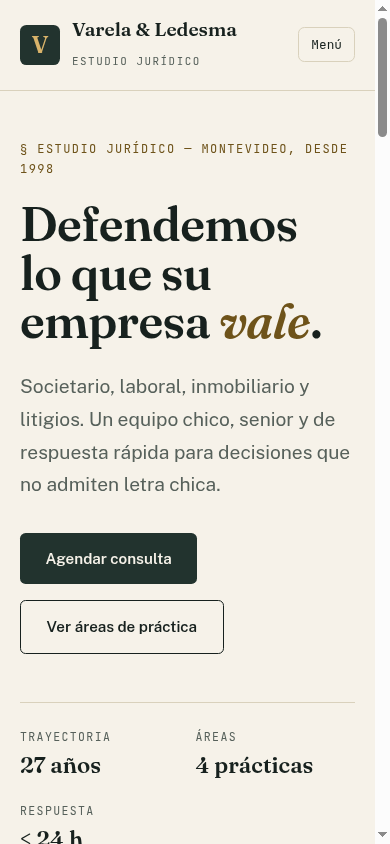
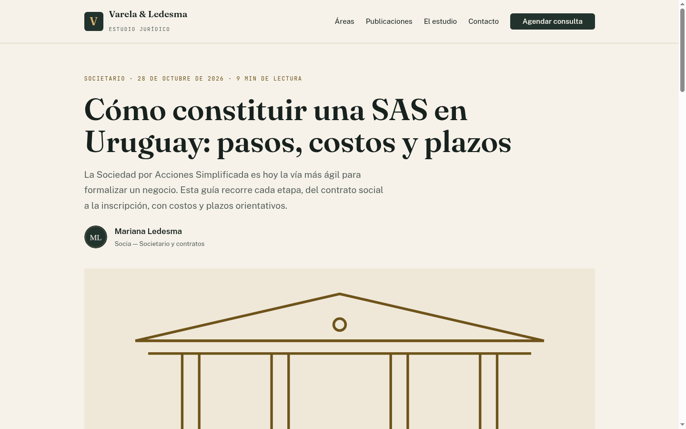
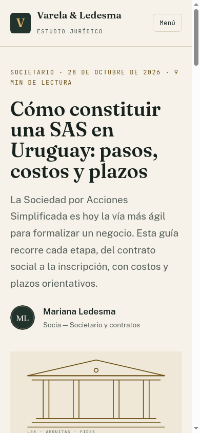
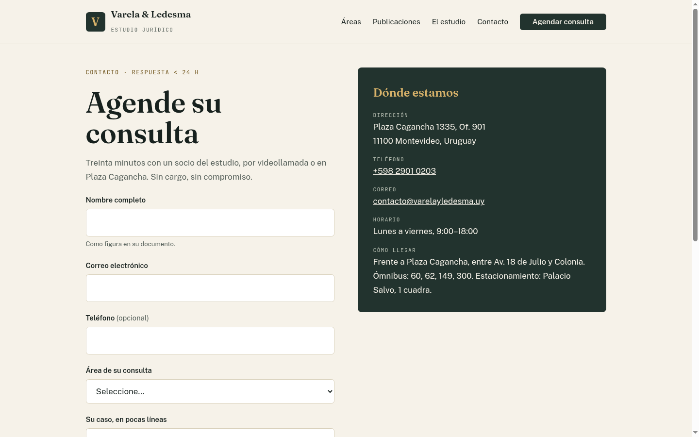
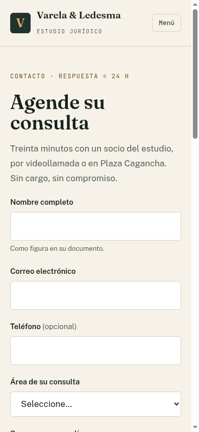

# Lawfirm Publisher — Custom WordPress Theme + Publishing Kit

A complete law-firm publishing kit for a fictional Montevideo firm (Varela & Ledesma):
custom WordPress theme (Gutenberg + ACF), deployable static demo mirror, and a
per-piece SEO checklist + 100-pieces/month publishing SOP.




**Live front end:** static mirror in `demo-static/` (deployable as-is to Netlify) ·
**Run locally:** `./demo.sh` → http://localhost:8020

## Problem

Law-firm marketing teams publish high volumes of legal content and need three
things: (1) a theme where editors ship consistent, on-brand articles without
page-builder soup; (2) every piece SEO-complete (meta, OG, alt text, headings,
schema); (3) a repeatable QA + publishing workflow that survives 100 pieces/month.
This repo delivers all three.

## Quickstart

**Static demo (no WordPress needed):**

```bash
./demo.sh              # serves demo-static/ on http://localhost:8020
./scripts/validate.sh  # structural + alt + headings + ban-list checks
```

**Theme install:**

1. Zip `lawfirm-publisher/` → upload via **Appearance → Themes → Add New**
   (or copy into `wp-content/themes/` and activate).
2. Install **Advanced Custom Fields** (free) — the article-hero field group
   loads automatically from `acf-json/article-hero.json`. Without ACF the theme
   degrades gracefully (category kicker, featured image, TOC on).
3. Assign menus (**Primary**, **Footer: practice areas**, **Footer: studio**),
   set the accent color in Customizer → Colors, create a Contact page (slug
   `contacto`), set a static front page.

## Screenshots

| Page | Desktop 1440 | Mobile 390 |
|---|---|---|
| Home |  |  |
| Article |  |  |
| Contact |  |  |

## Structure

```
lawfirm-publisher/     Custom WP theme — no build, no CDN, self-hosted fonts
  front-page.php       Hero + practice index + manifesto + latest posts
  single.php           ACF hero + sticky auto-TOC + author box + post nav
  acf-json/            Article hero field group (kicker, hero image, TOC toggle)
  screenshot.png       1200×900 theme preview
demo-static/           3-page static mirror (index, article, contact) + netlify.toml
docs/                  SEO-CHECKLIST.md (per-piece gate), PUBLISHING-SOP.md (ops)
scripts/               validate.sh, check_headings.py, inline_fonts.py, make_images.py
screenshots/           Desktop 1440 + mobile 390 QA captures
```

Theme details: Gutenberg-ready templates, customizer accent color, menus,
thumbnails, excerpts, reading time, auto-TOC from H2s, SEO meta/OG/schema.
Fonts are self-hosted woff2, base64-inlined into `site.css` (edit
`site.src.css`, rebuild with `inline_fonts.py`, commit both).

## Publishing workflow

- Per-piece gate: `docs/SEO-CHECKLIST.md`
- 100/month ops: `docs/PUBLISHING-SOP.md` (intake → format → SEO → QA → ship → log)

## License note

No `LICENSE` file in repo yet — the theme header in `style.css` declares
GPL v2 or later. Sample content only; no real client data.

---

**Tiago Colo** · colotiago8@gmail.com · [LinkedIn](https://www.linkedin.com/in/tiago-colo-640057402/)
